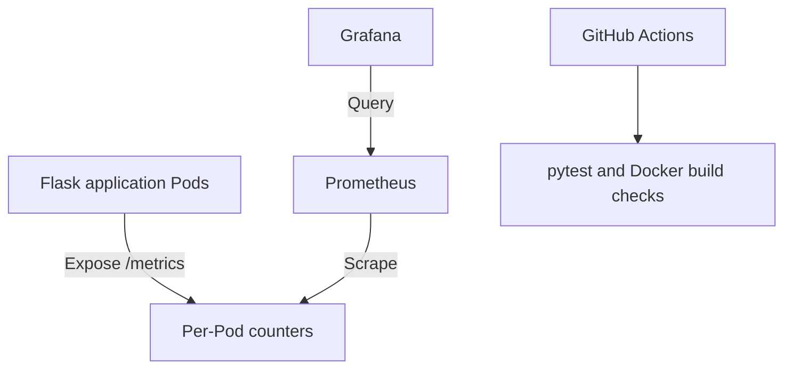

# SRE Reliability Lab

Independent hands-on project exploring application deployment,
observability, incident diagnosis, and automated validation.

Built with Python, Flask, Docker, Kubernetes (kind), Prometheus,
Grafana, and GitHub Actions.

## Completed work

### Application and containers

- Built a Flask HTTP service with separate health and readiness endpoints.
- Added pytest checks for default readiness, explicit unready behavior,
  and health responses.
- Packaged the service with Docker and Gunicorn, running as a nonroot user.
- Investigated container lifecycle, bind-mounted storage, and network
  binding failures.

### Kubernetes

- Deployed application replicas to a local kind cluster.
- Configured a ClusterIP Service, readiness and liveness probes,
  and CPU/memory requests and limits.
- Tested Pod replacement, replica scaling, and configuration reconciliation.
- Diagnosed an unavailable-image rollout and restored the working version.
- Verified that unready Pods were excluded from normal Service traffic.

### Observability

- Instrumented HTTP response counters by method, route, and status.
- Configured Prometheus Pod discovery with namespace-scoped,
  read-only Kubernetes permissions.
- Queried per-Pod metrics and aggregated request rates using PromQL.
- Built Grafana panels for application traffic, scrape success,
  and readiness response rates.
- Provisioned the Grafana data source and dashboard from ConfigMaps.
- Tested a readiness alert through inactive, pending, firing,
  and inactive states.

### Git and continuous integration

- Used feature branches, pull requests, and reviewed merges.
- Configured GitHub Actions to run pytest and build the Docker image.
- Introduced a controlled readiness regression, observed CI fail,
  and verified the correction returned it to green.

## Architecture

## Project layout

| Path | Contents |
|---|---|
| `app/` | Flask service and metrics instrumentation |
| `tests/` | Application behavior tests |
| `Dockerfile` | Container build and startup configuration |
| `k8s/` | Application and monitoring manifests |
| `dashboards/` | Exported Grafana dashboard |
| `.github/workflows/` | CI workflow |
| `docs/` | Lab procedures, observations, and troubleshooting notes |

## Verification and learning notes

The `docs/` directory records commands, observed failures, explanations,
and recovery steps. Exercises include:

- Container running but unreachable because of a loopback-only listener.
- Pod running but unready, while metrics remain scrapeable.
- Failed image rollout with the previous version still serving traffic.
- Grafana configuration restored after Pod replacement.
- Application regression detected by CI.

## Scope and limitations

This is a learning environment, not a production deployment.

- Kubernetes runs locally in a single-node kind cluster, not Amazon EKS.
- CI runs tests and builds an image; it does not publish or deploy it.
- Image loading and Kubernetes deployment remain manual.
- Prometheus and Grafana use temporary storage.
- Grafana provisioning recreates configuration, not historical data.
- Alert evaluation is configured; external notifications are not.
- One Gunicorn worker per application container avoids the need for
  multiprocess counter aggregation in this lab.